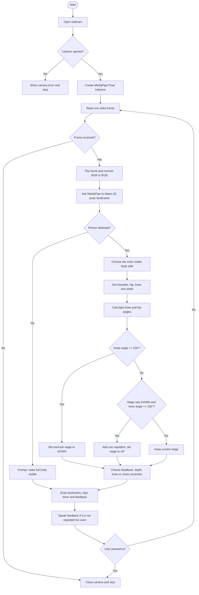

# AI-Based Squat Virtual Assistant

This beginner-friendly Python project uses a webcam, MediaPipe Tasks, and voice prompts to coach a basic bodyweight squat in real time. It detects body landmarks, checks simple joint angles, counts completed repetitions, shows elapsed time, and gives corrective voice feedback.

> **Safety note:** This is an educational demonstration, not medical or professional fitness advice. The angle rules are approximate. Stop if you feel pain, and seek guidance from a qualified trainer or clinician where appropriate.

## What the project checks

The app selects the more visible side of the body and uses these MediaPipe landmarks:

| Landmark | Why it is used |
| --- | --- |
| Shoulder | Measures how upright the torso is. |
| Hip | Connects the torso and thigh. |
| Knee | Main landmark for squat depth and repetition counting. |
| Ankle | Connects the lower leg and helps calculate the knee angle. |

The knee angle is formed by **hip → knee → ankle**. A standing position is about 160° or more. A squat is considered low enough at about 100° or less. The program counts one repetition only when the person goes down and then returns to standing.

## Flowchart



## Algorithm (plain English)

1. Start the webcam and create a MediaPipe Pose detector.
2. Repeatedly read a frame from the webcam.
3. Detect body landmarks in that frame.
4. If no body is visible, ask the user to move into view.
5. If a body is visible, choose the left or right side with better landmark visibility.
6. Use its shoulder, hip, knee, and ankle to calculate knee and hip angles.
7. Mark the squat as **down** when the knee angle is 100° or below.
8. Count a repetition when the user later returns to 160° or above.
9. Display the landmarks, angles, repetitions, elapsed time, and text feedback.
10. Speak feedback, while preventing the same message from repeating every frame.
11. Stop safely when the user presses `q`.

## Installation and running

1. Install Python and create a virtual environment (recommended).
2. Open a terminal in this folder.
3. Create and activate a virtual environment (recommended):

```powershell
py -m venv .venv
.\.venv\Scripts\Activate.ps1
```

4. Install the libraries:

```powershell
pip install -r requirements.txt
```

5. Run the app:

```powershell
python squat_virtual_assistant.py
```

On its first run, the program downloads the official MediaPipe pose model into this folder. An internet connection is needed only for that one download. Stand side-on to the camera and make sure your shoulder, hip, knee, and ankle are visible. Press `q` to quit or `r` to reset the counter and timer.

The project includes `fahhhhh.mp3`. When the assistant detects an unsafe knee or chest position, it plays this sound and speaks the correction. The sound has a short cooldown so it does not repeat continuously.

## Feedback rules used in this demo

| Situation | Feedback |
| --- | --- |
| Knee angle below 60° | Keep knees in line with toes. |
| Hip angle below 55° | Keep chest more upright. |
| Knee angle 100° or below | Good depth. Push through heels. |
| Otherwise | Lower slowly into your squat. |

These thresholds are intentionally kept visible at the top of the Python file so a beginner can experiment with them.
